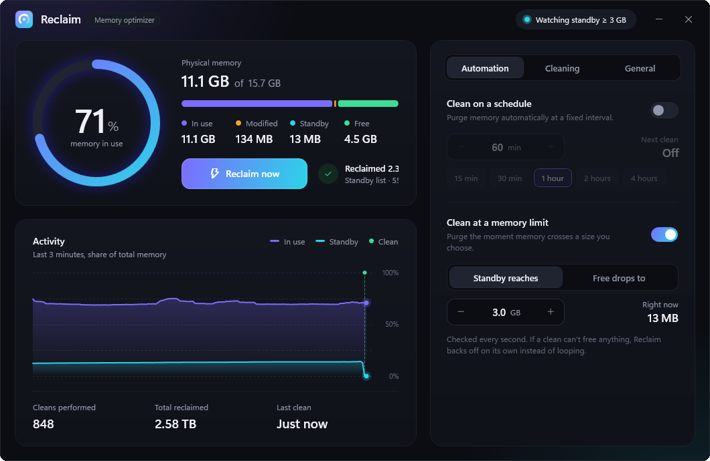

<div align="center">


# Reclaim

**A Windows memory optimizer that lives in the tray and frees memory on a schedule, at a limit you choose, or with one click.**

[](https://github.com/aly-abdullah/reclaim/releases/latest)
[](LICENSE)


[Download](https://github.com/aly-abdullah/reclaim/releases/latest) · [How it works](#how-it-works) · [Build from source](#build-from-source)

<br>



</div>

## Why Reclaim

After a long session with an IDE, a browser and a few containers, Windows often holds many gigabytes in its standby list. It releases them on demand, but on a busy machine that release can lag behind and the next heavy task starts slow. Reclaim asks Windows to give that memory back now, and can do it for you automatically.

## Features

- **Reclaim now.** One click, and the window shows how much was freed and how long it took.
- **Clean on a schedule.** Every 15 minutes, 30 minutes, 1 hour, 2 hours or 4 hours.
- **Clean at a memory limit.** Trigger when the standby list reaches a size you choose, or when free memory drops to one. If a clean frees very little, Reclaim waits longer before it tries again, so it never loops.
- **Choose what gets cleaned.** Standby list (recommended), modified page list, process working sets and the system file cache, each with its own switch.
- **Live view.** A ring gauge for memory in use, a bar that splits memory into in use, modified, standby and free, and a chart of the last three minutes.
- **Lives in the tray.** Minimize or close to the tray, pause and resume automatic cleaning, and get a notification with the amount reclaimed after each automatic clean.
- **Launch at sign-in** through a scheduled task, so it starts elevated without a UAC prompt, and can start straight into the tray.
- **Totals.** Number of cleans performed and total memory reclaimed.

## How it works

Reclaim uses the same Windows calls that system tools use for this job:

| Target | What Reclaim calls |
|---|---|
| Standby list | `NtSetSystemInformation` with `MemoryPurgeStandbyList` |
| Modified page list | `NtSetSystemInformation` with `MemoryFlushModifiedList`, which writes pending changes to disk and then frees those pages |
| Process working sets | `NtSetSystemInformation` with `MemoryEmptyWorkingSets` |
| System file cache | `SetSystemFileCacheSize` |

These calls need administrator rights, which is why Reclaim asks for elevation when it starts.

## Requirements

- Windows 10 or 11 (x64)
- [.NET 10 Desktop Runtime](https://dotnet.microsoft.com/download/dotnet/10.0)

## Install

1. Download `Reclaim.exe` from the [latest release](https://github.com/aly-abdullah/reclaim/releases/latest).
2. Put it in a permanent folder and run it. Accept the administrator prompt.

Windows SmartScreen may warn about an unsigned app the first time. Choose **More info**, then **Run anyway**.

## Good to know

- **Freed memory is not lost work.** The standby list is a cache. Windows refills it as you keep working, which is normal.
- **Working sets and the file cache are off by default.** Emptying them can make apps feel slower for a moment while they load their pages back. Turn them on only if you need them.
- **Launch at sign-in** creates a scheduled task named `Reclaim Memory Optimizer`. Turning the switch off removes it.

## Build from source

```bash
git clone https://github.com/aly-abdullah/reclaim.git
cd reclaim
dotnet build -c Debug
```

Publish a single-file build into `App/`:

```bash
dotnet publish -c Release -o App
```

### Project layout

```
Core/
  MemoryCleaner.cs    runs the selected clean targets and measures what was freed
  MemoryInfo.cs       reads the current memory snapshot
  ReclaimService.cs   one-second sampling, schedule, memory limit and backoff
  StartupManager.cs   launch at sign-in through a scheduled task
  Settings.cs         settings and totals
  Privileges.cs       enables the privileges the memory calls need
Controls/             ring gauge, composition bar and activity chart
Ui/                   view model, tray icon and tray menu
Themes/Theme.xaml     design tokens and control styles
MainWindow.xaml(.cs)  the window
```

## Contributing

Issues and pull requests are welcome. For larger changes, open an issue first so we can agree on the direction.

## License

[MIT](LICENSE) © 2026 Aly Abdullah
